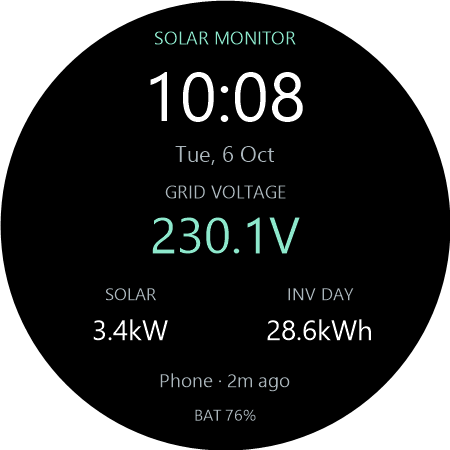

# Galaxy Watch companion and solar face

The watch app and face require API 33 or later (Wear OS 4+). The phone continues to support Android 10+. These are debug builds, not Play Store releases.

Direct watch gateway provisioning is temporarily hidden in the phone Settings while its connection flow is investigated. The watch can still display readings sent by the paired phone. A watch provisioned previously may continue using direct Wi-Fi, but there is currently no UI to set it up again.

## Install the three packages

The versioned distributables are in `dist`. After running `tools/Package-DebugBuild.ps1`, `dist/latest/` also contains stable filenames: `Unofficial-Enphase-Monitor.apk`, `Unofficial-Enphase-Wear.apk`, and `Unofficial-Enphase-Face.apk`, with version details in `build-info.json`. Packaging must be run again after building to refresh these copies.

- `Unofficial-Enphase-Monitor-1.1.15.apk`: update the **phone** app. Install over the existing app to preserve history, settings and the encrypted owner token.
- `Unofficial-Enphase-Wear-1.1.1.apk`: install on the **watch**. It intentionally has the same application ID and signing certificate as the phone app so Google's Wear Data Layer can connect them.
- `Unofficial-Enphase-Face-1.1.1.apk`: install on the **watch** as a separate face package. It contains resources only, without application code or gateway credentials.

Keep the phone and watch paired through Galaxy Wearable. Installing a phone APK does not automatically sideload the watch packages. Android Auto is unrelated to building or installing this Wear OS app.

For watch installation, enable Developer options, ADB debugging and Wireless debugging on the watch. Connect the computer and watch to the same home Wi-Fi. Open **Pair new device** on the watch, then use the pairing address, port and code it displays. Pairing and connection ports are usually different; use each displayed address, not the gateway's IP. See [Android's Wear OS debugging instructions](https://developer.android.com/training/wearables/get-started/debugging).

PowerShell, from this project directory:

```powershell
$adb = 'adb' # Android SDK platform-tools on PATH
& $adb pair WATCH_IP:PAIRING_PORT
# Enter the code shown on the watch when prompted.
& $adb connect WATCH_IP:CONNECTION_PORT
& $adb devices -l
& $adb -s WATCH_IP:CONNECTION_PORT install -r '.\dist\Unofficial-Enphase-Wear-1.1.1.apk'
& $adb -s WATCH_IP:CONNECTION_PORT install -r '.\dist\Unofficial-Enphase-Face-1.1.1.apk'
```

Replace the placeholders with the watch's displayed values. To update a USB-connected phone, use its actual serial from `adb devices -l`:

```powershell
& $adb -s PHONE_SERIAL install -r '.\dist\latest\Unofficial-Enphase-Monitor.apk'
```

You can also transfer the phone APK to the phone and open it. Turn off wireless debugging when testing is finished. Future phone and watch updates must remain signed with the same key; another key prevents updating these packages and breaks Data Layer communication.

## Set up readings and direct Wi-Fi

1. Open the updated phone app and confirm your gateway connection works. Keep using your existing owner token and certificate pairing.
2. Open **Unofficial Enphase Monitor** on the watch. Recent phone readings can sync without copying credentials to the watch.
3. New direct Wi-Fi setup is paused until the phone Settings control returns. If the watch was provisioned previously, connect it to home Wi-Fi to keep using direct readings while its app is open.
4. Close the watch app to stop direct access. Its in-flight HTTP request is cancelled and its Wi-Fi request is released. The latest readings remain cached. There is no watch background collector, boot receiver or scheduled gateway polling.

Direct gateway requests bind to the watch's Wi-Fi network, bypassing the phone's Bluetooth network proxy. That Wi-Fi network must reach the private gateway address. There is no remote internet access to the gateway in this build.

If you replace the owner token, change the gateway address, or re-pair a changed certificate on the phone, the watch will need re-provisioning for direct Wi-Fi once setup is restored. A token/certificate change is never silently transferred. The watch encrypts its token with its own Android Keystore key and excludes it from backups. Credentials are sent only in a targeted, nearby MessageClient exchange and never in persistent DataItems. Snapshot synchronization uses Google's Data Layer, which can use its encrypted cloud relay when devices are apart; this project operates no backend.

## Select the solar face

After installing both watch packages, long-press the current face, choose **Add watch face**, and select **Unofficial Enphase Monitor**. If the defaults need permission or have not been selected automatically, edit the face and choose these monitor sources:

- Central slot: **Solar monitor voltage**.
- Lower left: **Solar monitor power**.
- Lower right: **Solar monitor day energy**.
- Bottom status: **Envoy data status**.

The providers also work on existing faces with matching short-text / long-text complication slots. Tap a populated solar complication to open the watch app. The clock follows the watch's 12/24-hour setting; date and battery come from the watch itself. Ambient mode uses a black background, no seconds or animation, and neutralizes the main voltage color.



## Update behavior and meaning

The watch app prefers phone readings when the phone says it is collecting, its publication is at most two minutes old, and its grid report is at most ten minutes old. Otherwise it reads directly every minute while open, after direct access is provisioned. A newer direct gateway report remains selected until the phone catches up. Cached snapshots and delivery order are checked before accepting a phone update.

The phone's configured refresh interval is respected during routine watch synchronization. The watch requests the phone's latest cache without forcing another gateway check. The watch app's direct Wi-Fi checks remain once a minute while open, and complication updates remain on Wear OS's five-minute schedule. Choosing a long phone interval can cause the face's voltage/power to expire between phone checks.

Complications read only the local cache. They request scheduled updates every five minutes and limit pushed update requests to once per five minutes. Wear OS may defer these updates for battery reasons. Opening the watch app can refresh its screen sooner, but the face is not a continuous live meter.

- Voltage, solar power and status validity end ten minutes after the **gateway report timestamp**, not after delivery. Old readings return no-data. The face includes empty-state labels; check their rendering on the actual watch.
- Status displays the selected source or configured voltage warning and an age that Wear OS advances without new gateway requests.
- **INV DAY** is the sum of nine distinct inverters' reported day energies when all nine reports belong to the watch's current local date. It remains available in the evening, expires at local midnight, and hides mismatched/previous-day totals. It is a reported source counter, not a calculation from meter cumulative energy.
- The watch app keeps older inverter telemetry visible with its actual report date and a cached/stale label after twenty minutes. The `modGone` flag alone is not classified as a fault.
- The phone remains the 30-day history recorder and voltage-alert source. Normal phone notifications may mirror to the watch through your notification settings. Direct watch mode shows warnings in the app without duplicate voltage notifications.

For updates while **both screens are closed**, enable **Monitor while app is closed** in phone Settings. If that collector stops or cannot reach the gateway, the face eventually expires its voltage/power. Opening the face never starts the phone service or watch gateway polling.

## Acceptance checks on the real devices

These checks remain for a real watch. New direct Wi-Fi provisioning and re-provisioning checks are paused while the phone setup control is hidden.

1. Update the phone and confirm saved token, thresholds and history survive. Install both watch packages and open the watch app.
2. Compare daytime gateway voltage, solar power and one IQ8P's AC/DC voltage with the gateway JSON. Rotate the physical bezel to scroll the dashboard and inverter detail screens. Check readability and clipping on your Watch6 screen size.
3. With the phone collecting, confirm the watch labels phone readings. Direct Wi-Fi checks require a previously provisioned watch until phone setup is restored.
4. Close the watch app with phone monitoring off. Confirm gateway requests stop, including a slow in-flight request. After ten minutes, check the face's no-data rendering. Leave it past midnight and confirm yesterday's inverter total disappears.
5. Enable phone continuous monitoring, close both screens, and verify new face reports over several five-minute intervals. Repeat with the phone locked and after leaving/returning home Wi-Fi. Follow the phone overnight checks in README.md.
6. Test expired-token handling and Wi-Fi unavailability. Re-provisioning after token/certificate changes waits for phone setup to return. Confirm no credentials appear in logs or complication data.
7. Choose each provider on another compatible face, verify tap actions, and check ambient rendering, date, battery and 12/24-hour time. Confirm desired phone notification mirroring without direct-watch duplicates.

## Source modules and checks

`gateway-core` holds the shared parser, unit conversion, certificate pinning, cancellable HTTP, encrypted settings, cache and versioned handoff protocol. `app` retains Room history and the foreground recorder and adds provisioning plus snapshot publishing. `wear` supplies visible-only direct collection, circular Compose screens, rotary scrolling and four cache-only complication providers. `solar-face` supplies a code-free WFF v1 face.

Run `gradlew.bat --no-daemon --offline testDebugUnitTest assembleDebug lintDebug` after initial dependency resolution, then `tools/Package-DebugBuild.ps1` to verify and copy the distributables into `dist`. `tools/New-FacePreview.ps1` regenerates the catalog preview from the face geometry with example readings.

Official references: [Data Layer](https://developer.android.com/training/wearables/data/overview), [watch networking](https://developer.android.com/training/wearables/data/network-communication), [complication providers](https://developer.android.com/training/wearables/complications/exposing-data), [WFF setup](https://developer.android.com/training/wearables/wff/setup), and [Google's face validators](https://github.com/google/watchface).
